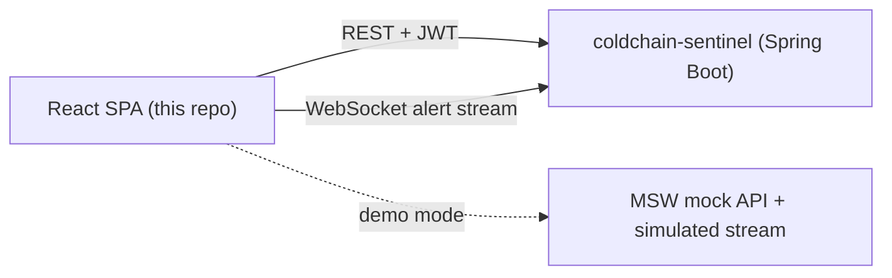

# Sentinel Console

[](https://github.com/KaparthyReddy/sentinel-console/actions/workflows/ci.yml)

A real-time, accessible operations dashboard for cold-chain temperature monitoring, built with React and TypeScript. It is the front end for [`coldchain-sentinel`](https://github.com/KaparthyReddy/coldchain-sentinel), a Spring Boot API that detects temperature excursions on pharmaceutical shipments.

**Live demo:** LIVE_DEMO_URL (runs on sample data; sign in with a demo account below)

> **Status:** the app runs on a built-in mock API by default, so it works with no backend. Pointing it at a real API is a configuration change (see [Connecting to a real backend](#connecting-to-a-real-backend)).

## Features

- **Dashboard:** summary figures, shipments at risk, and a live alert feed that updates over WebSocket with automatic reconnection and backoff.
- **Shipments:** searchable, filterable, paginated table. A detail page shows each shipment's temperature history in a chart, with a data table alternative.
- **Alerts:** filter by severity and status. Operators and admins can acknowledge and resolve alerts.
- **Thresholds:** admin-only page for editing each product's allowed temperature range, with accessible form validation.
- **Role-based access:** `ADMIN`, `OPERATOR` and `VIEWER` roles control routes, navigation and actions.
- **Responsive and themed:** mobile-first layout; light and dark themes follow the operating system.

## Tech stack

| Area | Choice |
| --- | --- |
| UI | React 18, TypeScript (strict), React Router |
| Server state | TanStack Query |
| Charts | Recharts |
| Styling | Plain CSS with design tokens and CSS Modules (no UI library) |
| Mock API | Mock Service Worker (MSW) plus a simulated WebSocket |
| Unit and component tests | Vitest, React Testing Library, vitest-axe |
| End-to-end and accessibility tests | Playwright, axe-core |
| Components | Storybook |
| Quality | ESLint (with jsx-a11y), Prettier |
| CI and hosting | GitHub Actions, Azure Static Web Apps |

## Architecture



- `src/api/` is the only place that talks to the network (`client.ts`, `endpoints.ts`, `services.ts`, query hooks).
- `src/auth/` holds the auth context, route protection and the role/permission table.
- `src/features/` holds feature modules (alerts, shipments, dashboard, thresholds); `src/components/` holds shared UI and layout.
- `src/mocks/` is the mock API. It is loaded only when `VITE_USE_MOCKS=true`.

## Quick start

Requires Node 20 or newer.

```bash
git clone https://github.com/KaparthyReddy/sentinel-console.git
cd sentinel-console
cp .env.example .env
npm install
npm run dev
```

Open http://localhost:5173 and sign in with a demo account:

| Role | Username | Password | Can do |
| --- | --- | --- | --- |
| Admin | `admin` | `admin123` | Everything, including editing thresholds |
| Operator | `operator` | `operator123` | View data, acknowledge and resolve alerts |
| Viewer | `viewer` | `viewer123` | Read-only |

These are fake credentials for the mock API only.

## Scripts

| Command | What it does |
| --- | --- |
| `npm run dev` | Start the dev server |
| `npm run build` / `npm run preview` | Type-check, build, and serve the build |
| `npm test` / `npm run test:coverage` | Unit and component tests |
| `npm run e2e` | Browser tests (desktop and mobile) plus accessibility scans |
| `npm run storybook` | Component explorer on port 6006 |
| `npm run lint` / `npm run typecheck` / `npm run format:check` | Static checks |

## Testing

- **Unit and component tests** (Vitest, React Testing Library, MSW): utilities, the API client, auth, hooks (including WebSocket reconnect/backoff with fake timers), UI components, features and routing. Component tests also run axe.
- **End-to-end tests** (Playwright): sign-in and redirects, role-based access, dashboard, live alerts, shipment search, and token storage. They run at desktop and phone sizes against the production build.
- **Accessibility scans** (axe-core, WCAG 2.1 A/AA tags): every page in light and dark mode at both sizes, including form validation states.

Automated tools find only part of the accessibility problems. Keyboard and screen-reader checks are still recommended before relying on this in production.

## Accessibility

- Skip link, landmarks, one `<h1>` per page, and a unique document title per route.
- Focus moves to the main content after navigation; Escape closes the mobile menu.
- Visible focus rings; touch targets of at least 44px; `prefers-reduced-motion` respected.
- Form fields use real labels with `aria-describedby` and `aria-invalid`. Errors are announced and focus moves to the first problem.
- Status is never colour alone: badges always carry text.
- The temperature chart has a generated text summary and a data table alternative.
- Live alert updates are announced politely, one at a time.

## Security

- **Token handling:** the JWT is kept in memory only, never in `localStorage` or `sessionStorage`, so an XSS bug cannot read it from storage. The trade-off is that a page refresh signs the user out. A refresh token in an `HttpOnly` cookie would fix that and needs backend support.
- **Content Security Policy** and other headers are set in `public/staticwebapp.config.json` (no inline scripts, no third-party origins). Tighten `connect-src` to your exact API host.
- **Open-redirect guard:** the post-login redirect only accepts same-site paths.
- **Least privilege:** unknown roles from the server are treated as `VIEWER`.
- **UI gating is not security.** Hiding buttons and routes is a convenience. The API must enforce permissions, and the mock API does (it returns 403).
- **WebSocket auth:** browsers cannot set headers on a WebSocket, so the token is sent as a query parameter. Query strings can appear in server logs. A short-lived, single-use ticket obtained over REST is the safer design.

## Connecting to a real backend

1. Set `VITE_USE_MOCKS=false`, `VITE_API_BASE_URL` and `VITE_WS_URL` in `.env`.
2. Allow the app's origin in the API's CORS configuration.
3. Make the API match `src/api/endpoints.ts` and `src/api/types.ts`, or adjust those files.

| Endpoint | Returns |
| --- | --- |
| `POST /api/auth/login` | `{ token, username, role }` |
| `GET /api/dashboard/summary` | `{ activeShipments, shipmentsAtRisk, openAlerts, criticalAlerts }` |
| `GET /api/shipments?page&pageSize&search&status` | `{ items, total, page, pageSize }` |
| `GET /api/shipments/:id` and `/readings` | a shipment, and its `[{ timestamp, temperatureC }]` |
| `GET /api/alerts?page&pageSize&severity&status` | `{ items, total, page, pageSize }` |
| `POST /api/alerts/:id/acknowledge` or `/resolve` | the updated alert |
| `GET /api/thresholds` and `PUT /api/thresholds/:id` | product temperature ranges |

The WebSocket should send each new alert as JSON, either bare or wrapped as `{ "type": "alert", "alert": { ... } }`. If the API returns Spring Data's `Page` shape (`content`, `totalElements`), map it to `Paged<T>` in `src/api/services.ts`.

## Deployment

The `Deploy to Azure Static Web Apps` workflow builds the app and deploys it to Azure Static Web Apps, with preview environments for pull requests. It needs one repository secret, `AZURE_STATIC_WEB_APPS_API_TOKEN`. The deployed demo is built in mock mode.

## Design decisions

- **No UI library.** Components are built on semantic HTML and design tokens, so accessibility is explicit and visible in the code.
- **TanStack Query for server state.** Caching, retries, and invalidation when a live alert arrives, instead of hand-written effects.
- **A WebSocket abstraction the tests can fake.** `useAlertStream` depends on a small socket interface, so reconnect logic is tested deterministically without a network.
- **Mock API at the network layer (MSW).** The same handlers serve the dev server, the tests and the demo, so the app code never knows it is mocked.

## Limitations and next steps

- Runs on sample data by default; the real-backend path is configurable but not deployed.
- Refreshing the page signs you out (see Security).
- Recharts 2.x is in use; upgrading to 3.x is a possible follow-up.

## License

[MIT](LICENSE)
